<!-- SPDX-License-Identifier: Apache-2.0 -->
# stagegate-agents

[](https://github.com/BuchbinderNatalia/stagegate-agents/actions/workflows/ci.yml)
[](https://securityscorecards.dev/viewer/?uri=github.com/BuchbinderNatalia/stagegate-agents)
[](LICENSE)


**stagegate-agents lets AI agents build software the way a careful team does.** They research,
plan, write code and tests, and review each other's work, while a person approves the important
steps and automatic checks stop unsafe actions, like publishing a password or merging broken code.

| Built and proven in production | |
|---|---|
| Changes shipped with it on the [StarPulse](https://starpulse.dev) platform | **56** |
| Live AI test runs passed (hidden acceptance tests, independent reviewers) | **15 / 15** |
| Automated tests guarding the project itself | **280+** |
| Secrets in the code history (checked by 3 independent scanners) | **0** |
| OpenSSF security score (November 2026) | **7.1 / 10** |

*Built by Natalia Buchbinder · [LinkedIn](https://www.linkedin.com/in/natalia-buchbinder) ·
[Case study](docs/CASE_STUDY.md) · [Eval results](docs/EVAL_RESULTS.md)*

### For engineers

**A staged, human-gated delivery pipeline for [Claude Code](https://claude.com/claude-code), whose
rules are enforced by code, not just by prompts.** Nineteen specialised agents take a feature from
idea to merged pull request: research, user story, technical brief, test plan, implementation,
tests, independent validation and review. You approve the story, the brief and the final result;
guard hooks, the OS sandbox and CI enforce the rest: no commits of secrets, no pushes to `main`,
no merging a red PR, no load tests against production. It was extracted from
**[StarPulse](https://starpulse.dev)**, a production app on AWS EKS that one developer built and ran
with these agents ([case study](docs/CASE_STUDY.md)), and installs into any Python repository with
one command.

## How it works

```mermaid
flowchart LR
    idea([Feature idea]) --> R[codebase-researcher]
    R --> S[story-writer]
    S --> G1{{"⛔ Gate 1<br/>human approves story"}}
    G1 --> B[spec-writer]
    B --> G2{{"⛔ Gate 2<br/>human approves brief"}}
    G2 --> T[test-strategist]
    T --> BB[backend-builder]
    T --> FB[frontend-builder]
    BB --> TV[test-verifier]
    FB --> TV
    TV --> V[implementation-validator]
    V -- Critical findings --> BB
    V -- none --> G3{{"⛔ Gate 3<br/>human approves result"}}
    G3 --> PR[Pull request]
    PR --> RV[pr-reviewer]
    PR --> CI[CI checks]
    RV --> MG{{"🔒 merge gate<br/>all checks green?"}}
    CI --> MG
    MG -- yes --> M([merged])

    subgraph guards [Enforced on every shell command]
      direction TB
      H1[commit guard: secrets, :latest tags, commits to main]
      H2[merge gate: no merge while CI is red]
      H3[load-test guard: local hosts only]
      SB[OS sandbox: no credential stores, allowed domains only]
    end
```



1. **`/feature-factory <idea>`** runs the chain above. Each agent has one job and the smallest tool
   set that job needs: researchers, writers and validators can't edit files; the reviewer can't
   either.
2. **Three human gates.** Nothing is built before you approve the story and the brief, and nothing
   becomes a pull request before you approve the result.
3. **Validation loop.** `implementation-validator` checks the code (not the summaries) against every
   acceptance criterion; Critical findings go back to the builder until there are none.
4. **Guards run on every Bash command**, as Claude Code
   [PreToolUse hooks](https://code.claude.com/docs/en/hooks). They read the actual command (quotes,
   heredocs, `bash -c`, `eval`, wrappers) and block with exit code 2, fail closed when they can't
   check, and have 130+ regression tests.
5. **Sandbox on by default.** Shell commands can't read `~/.aws`, `~/.ssh`, `~/.kube` or your GitHub
   login, and reach only GitHub and PyPI.
6. **Optional infra pack** (`--with-infra`): 9 more agents for Terraform, Kubernetes, CI/CD, ArgoCD
   and monitoring, plus a hardened deploy workflow (OIDC, SHA-pinned actions, scan gate).

Details: [docs/ARCHITECTURE.md](docs/ARCHITECTURE.md) · Safeguards vs. the OWASP agentic risks:
[docs/GOVERNANCE.md](docs/GOVERNANCE.md)

## Quickstart (5 minutes, on the sample app)

Requirements: git, Python 3.11+, [Claude Code](https://code.claude.com/docs/en/quickstart), and the
GitHub CLI (`gh`) for pull requests.

```bash
git clone https://github.com/BuchbinderNatalia/stagegate-agents.git
SG="$PWD/stagegate-agents"
cp -r "$SG/examples/sample-app" /tmp/bookshelf
cd /tmp/bookshelf && git init -q -b main && git add -A && git commit -qm init

"$SG/scripts/install.sh" .     # writes stagegate.toml, agents, hooks, settings
"$SG/scripts/doctor.sh" .      # checks Python, git, claude, gh, sandbox
git add -A && git commit -qm "chore: add stagegate"

claude
> /feature-factory export the catalogue as CSV
```

You'll be asked to approve the user story, then the technical brief, then the result. The agents
work on a `feat/…` branch; the guards stop them if they try to commit secrets or push to `main`.

### Install into your own repository

```bash
# one command, pinned to a release (add --with-infra for the infra pack)
curl -fsSL https://raw.githubusercontent.com/BuchbinderNatalia/stagegate-agents/v0.1.0/scripts/install.sh \
  | bash -s -- /path/to/your/repo
```

Set `STAGEGATE_SHA256` to the checksum on the [release page](https://github.com/BuchbinderNatalia/stagegate-agents/releases)
to verify the download, or verify its build provenance with
`gh attestation verify stagegate-agents-v0.1.0.tar.gz --repo BuchbinderNatalia/stagegate-agents`.
Prefer to read before you run? Clone and use `scripts/install.sh --dry-run`.

The installer never overwrites files you've changed, keeps your existing `CLAUDE.md` and
`settings.json` content, and is undone by `scripts/uninstall.sh`. Everything is configured in one
file, [`stagegate.toml`](templates/stagegate.toml).

## What's in the box

| | |
|---|---|
| **Core agents (10)** | codebase-researcher, story-writer, spec-writer, test-strategist, backend-builder, frontend-builder¹, test-verifier, e2e-test-writer, implementation-validator, pr-reviewer |
| **Infra pack (9)** | infra-researcher, iac-builder, k8s-manifest-writer, cicd-pipeline-builder, infra-validator, monitoring-config-writer, argocd-config-writer², argocd-validator², gitops-pipeline-builder² |
| **Skills (5)** | `/feature-factory`, `/build-with-tests`; infra: `/infra-factory`, `/infra-change-review`, `/deploy-checklist` |
| **Guard hooks (3)** | commit guard, merge gate, load-test guard |
| **Stack profiles** | `python`, `python-fastapi`, `react-ts` (add your own: [EXTENDING](docs/EXTENDING.md)) |
| **Tooling** | installer, uninstaller, doctor, success-rate evals, opt-in pytest network guard |

¹ only when the project has a frontend · ² only with `gitops = "argocd"`

## Quality

- **260+ offline tests:** unit tests for every guard and script, an integration test that runs a
  builder cycle on the sample app through the real installed hooks, and an end-to-end test of
  PR → review → merge gate. A fake `claude` and fake `gh` make them free and deterministic.
- **Success-rate evals** ([`evals/`](evals/run.py)): 5 tasks with hidden acceptance tests the agents
  never see; a run passes only with clean git discipline, no regressions, the hidden tests green and
  0 Critical from an independent validator and reviewer. **Live: 15/15 runs passed**, with a clean
  reviewer approval on 12/15. On the other 3 the reviewer caught a real design flaw in one
  task's own brief ([results](docs/EVAL_RESULTS.md)).
- **Supply chain:** zero runtime dependencies; dev tools installed from a hash-locked file; every
  GitHub Action pinned to a commit SHA; CodeQL, OpenSSF Scorecard, dependency review, gitleaks and
  trufflehog, actionlint and zizmor (also on the workflows it generates); signed build provenance
  on releases.

## Design decisions

- **Humans decide, code enforces.** Agents are told the rules in prompts, but the rules that matter
  (no secrets, no direct pushes, no red merges, no remote load tests) are enforced by hooks that
  parse the real command. Prompts drift; hooks don't.
- **Least privilege per agent.** Read-only roles get read-only tools. A test fails the build if a
  validator ever gains Edit or Write.
- **Independent judging.** In the evals the validator and reviewer run as separate Claude sessions,
  so the builder never grades its own work.
- **Fail closed.** A guard that can't check a command (no Python 3.11, broken config) blocks it.
- **Sandbox by default.** Hooks are guardrails; the OS sandbox is the wall behind them, against
  prompt injection and mistakes alike.
- **Stack-neutral core.** Agents read stack rules from a profile, so supporting a new stack means
  writing one file, not editing nineteen agents.
- **No credentials in CI.** Real-Claude tests and evals run locally with your own login; CI uses
  fakes and never stores a Claude key.

Known limits are written down, not hidden: hooks can't see merges done in the web UI or commands
assembled at runtime; the reviewer's "read-only git" Bash access is an instruction, because Claude
Code can't restrict Bash per agent. See [GOVERNANCE](docs/GOVERNANCE.md#known-gaps).

## Documentation

[Architecture](docs/ARCHITECTURE.md) · [Extending](docs/EXTENDING.md) ·
[Governance & OWASP mapping](docs/GOVERNANCE.md) · [Case study](docs/CASE_STUDY.md) ·
[Eval results](docs/EVAL_RESULTS.md) · [Contributing](CONTRIBUTING.md) · [Security](SECURITY.md) ·
[Changelog](CHANGELOG.md)

## Author

**Natalia Buchbinder**: designed and built stagegate-agents and the StarPulse platform it came from.

- LinkedIn: [linkedin.com/in/natalia-buchbinder](https://www.linkedin.com/in/natalia-buchbinder)
- GitHub: [@BuchbinderNatalia](https://github.com/BuchbinderNatalia)

If you use stagegate-agents in your work, please cite it ([CITATION.cff](CITATION.cff)).

## License

[Apache-2.0](LICENSE). Redistributions must keep the attribution in [NOTICE](NOTICE).
